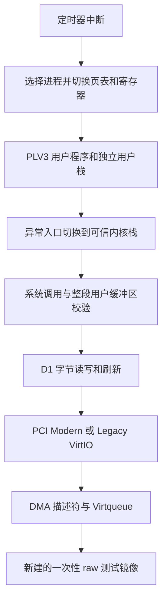

# LoongArch 用户态、调度与 PCI 磁盘独立验证

本轮把原有的页表、异常、物理页分配和上下文基础连接起来，形成可独立运行的用户态与磁盘实验。它没有修改 `xv6-riscv/`，没有接入队友的 VFS、ext2 或 FAT32；不是已经完成的 LoongArch xv6 产品。

## 已实现的链路



### 用户态和调度

- 七个独立地址空间，共享只读代码页，各自有数据页和用户栈；每个进程拥有独立页表根。
- 两个正常程序实际运行于 PLV3，执行系统调用后返回用户态。两个进程在相同虚拟地址保存不同内容，验证数据和寄存器不会串用。
- 普通异常和 TLB 重填分别使用 CSR.SAVE0/SAVE1 保存的可信内核栈入口，避免在用户栈上保存内核异常现场。整数寄存器、用户 SP、ERA 和前态均保存/恢复。
- 支持主动让出、周期定时器抢占、退出及进程资源回收。切换根页表时清理 TLB；当前使用 ASID=0，不声称实现多 ASID 优化。
- 五个故意出错的进程分别尝试访问内核 DMW、读取低地址特权页、写只读代码页、执行 NX 数据页及读取用户栈保护空洞。测试核对实际故障 PC、地址、原因，终止对应进程，其他进程继续运行。
- 用户缓冲区复制先检查完整范围，再逐页使用内核直接映射地址复制；拒绝权限不足、未映射和整数溢出，避免检查到一半才修改目标。

这些进程和调度对象是独立验证框架，不是 xv6 的 `proc`、`fork`、`exec` 或 `wait` 实现。浮点/向量现场、多核和嵌套内核中断不在本轮范围。

### 实验系统调用

| 编号 | 含义 | 范围 |
|---|---|---|
| 0 | 获取当前实验进程编号 | 基础用户态实验 |
| 1 | 向串口输出用户缓冲区 | 最长 64 字节，验证 copyin |
| 2 / 3 | 主动让出 / 退出 | 独立调度实验 |
| 4 | 将编号信息写回用户缓冲区 | 验证跨页 copyout 和只读拒绝 |
| 5 | 查询实验时钟计数 | 用于核对定时器抢占 |
| 6 | 报告用户测试断言失败 | 仅测试入口 |
| 7 | 查询块设备字节容量 | 仅 user-disk 目标 |
| 8 / 9 | 块设备读取 / 写入 | 参数为设备、字节偏移、用户缓冲区、长度；每次最多 512 字节 |
| 10 | 块设备刷新 | 仅 user-disk 目标 |

未知调用返回 -1。这些编号是实验约定，不是 Linux 或团队 xv6 的正式系统调用 ABI。磁盘接口没有文件路径语义。

### PCI VirtIO 与 D1

`pci-block.c` 提供与团队 D1 对应的 `blk_read/write/size/flush` 同步字节接口。通过 PCI ECAM 枚举 bus 0 的 function 0，识别 Modern 和 Legacy block 设备，分配 BAR，建立每设备独立的队列、请求、状态和扇区缓冲区。

- Modern 模式解析公共配置、通知、ISR 和设备配置能力，协商 VERSION_1、只读及 FLUSH，配置队列物理地址。
- Legacy 模式使用 PCI I/O BAR、QueuePFN 和 4 KiB 对齐环。
- 仅一条请求在设备队列中执行，通过轮询完成项及设备状态返回结果；带等待上限。当前不依赖中断控制器或调度器休眠。
- 内核调用方的缓冲区统一经每设备的 512 字节 bounce buffer 中转；非对齐写入执行部分扇区读改写。
- 设备 1 固定写保护；设备 2 为测试读写盘；设备 3 由 QEMU 以只读方式提供。非法设备、空缓冲区、容量越界和溢出被拒绝。
- FLUSH 未协商成功时返回失败，不将空操作声称为刷新成功。

接口成功返回 0，失败返回 -1。多扇区传输在中途遇到设备错误时，前序扇区可能已经完成，不提供事务回滚；用户复制的整段权限预检查不能被解释成磁盘事务保证。

MMIO/ECAM/PIO 地址依据 QEMU 7.2 的 `include/hw/pci-host/ls7a.h` 和 `hw/loongarch/virt.c`。协议依据 [OASIS VirtIO 1.2 规范](https://docs.oasis-open.org/virtio/virtio/v1.2/virtio-v1.2.html)，并与 QEMU 的 `virtio_pci.h`、`virtio-pci.c` 对照。

当前支持测试平台上的最多三台设备、固定插槽与资源窗口，不支持任意 PCI 拓扑、热插拔、动态重配置、分区或真实板卡。单 CPU 下串行使用，不可直接当作支持并发和休眠的正式内核驱动。

## 统一复现

在 Ubuntu/WSL 中配置现有工具链。QEMU 需要包含前一阶段说明中的官方 PNX 递归异常修复。

```sh
cd block-device-and-loongarch/loongarch-probe
export LOONGARCH_CROSS=/path/to/loongarch64-unknown-linux-gnu-
export LOONGARCH_QEMU=/path/to/qemu-system-loongarch64
python3 run_probes.py
```

脚本创建新的源码构建副本和一次性镜像，不接受真实磁盘路径。`disk_matrix.py` 验证 Modern、Legacy、混合三盘配置、单根盘、无设备、FLUSH 后同镜像重启和 blkdebug 注入读错误。宿主逐字节核对全部三盘，检查读改写的相邻字节，以及根盘、只读盘不被修改。

用户态到磁盘的闭环在 Modern、Legacy 两种模式分别运行。两个正常程序向设备 2 的各自扇区写入不同模式、刷新并读回；宿主再次核对写入内容和其他区域。manifest 记录每次命令、源码和脚本 SHA256、镜像前后及期望校验值。具体通过项数以本轮验收记录为准。

## 单独运行与展示

用户态实验可以直接构建和运行：

```sh
make user CROSS="$LOONGARCH_CROSS"
"$LOONGARCH_QEMU" -machine virt -smp 1 -m 2G -nographic -nic none \
  -kernel build/user-probe.elf
```

展示整条用户态到磁盘链路，推荐使用：

```sh
python3 demo_platform.py
# 使用 Legacy 设备
python3 demo_platform.py --transport legacy
# 自动捕获输出并检查后退出
python3 demo_platform.py --check
```

演示脚本会创建全新镜像并编译。看到 `user: ALL PASS` 后程序保持空闲，按 Ctrl+A 再按 X 退出。输出中两个进程的问候来自真实用户态系统调用；五条隔离日志是预期的保护测试，不是演示故障。

## 需要团队协作的后续

本轮已经覆盖可在当前独立实验基线验收的用户态、最小系统调用、抢占调度、PCI 磁盘、D1 以及跨层读写。后续不应继续无限堆叠独立样例，应与主线维护者确定正式接入：

1. 确定架构目录、构建选择、启动和异常帧 ABI；独立实验对象不能整体覆盖公共内核文件。
2. 将可信内核栈、页表切换、调度和用户复制接入正式进程生命周期；补 `fork/exec/wait` 等真实内核功能。
3. 接入正式块设备调用路径和并发机制，再与 VFS、ext2/FAT32 联调，运行 shell 和完整回归。
4. 确定正式 RAM 发现、保留区和内存布局。当前仍为预留 1 MiB 页池，不能声称已管理整机内存。

完整 LoongArch xv6、文件系统挂载和最终成品验收仍未完成；之前集成版本的偶发内核异常也不因本轮独立实验通过而自动关闭。
