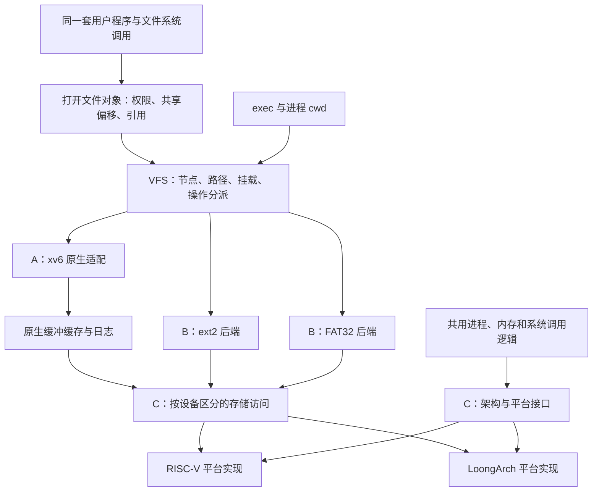

# 统一架构与接口约定

2026-10-21 正式联调：`codex/integration` 已在 `~/AdvancedOS-integration` 建立，源码基线 `3e5c98d`。VFS 专项、挂载真实 ext2 时的完整 69 项原生回归、路径及单盘兼容通过；目录枚举和坏元数据 panic 仍待修，G1 未放行。本轮不变更公共 ABI。见 [正式联调记录](2026-10-21-01-正式联调分支建立与验证.md)。


2026-10-20 第二份资料更新：C 的 `hal-platform@f14ef4f` 已提交 D1 栈缓冲修复；B 内仍为旧驱动。两份贡献已独立提取，按 A@9f6add0→C新版→B 还原和 D1 快速矩阵通过，ext2 readdir/错误传播仍待修，G1 未正式放行。新入口见 [两名队友总体分析](2026-10-20-02-两名队友总体分析与成果提取.md)。以下第一轮“D1 栈缓冲缺陷”的判断适用于旧版本，不能用来否定 C 新交付；本轮不变更任何公共 ABI。

2026-10-20 接入状态索引：A 的 `codex/vfs@9f6add0` 已于 10 月 19 日上传；B 提供的本地候选 `B-ext2@a9e1454` 已合入该 VFS 和 C 的 D1/多盘，三个 VFS 共享头文件相对 A 无变化。D1 已有候选实现，不能再统称“没有代码”，但本轮发现内核栈缓冲区传输缺陷；ext2 内核只读已有代码，尚未通过正式 G1。详情、错误复现与修复责任见 [10 月 20 日对接方案](2026-10-20-01-oswork进度核验与对接方案.md)。本条不新增 ABI、不把候选或临时诊断当作主线验收；下方各阶段状态按历史解释。实例构造采用第 4.13 节四参数版本，readdir 采用第 4.14 节，禁止回用早期三参数声明。

版本：协作设计 v1，2026-10-01。

2026-10-06 提交登记：第四步写入/清零截断/位置锁已由用户提交于 Ubuntu codex/vfs，提交号 `83f892d02a9bf9352f392162e3f78a9dca4526c7`，7 个文件 +130/-40，源码子目录干净。本步完整 usertests 按用户反馈通过，日志位置 `/home/jelians/AdvancedOS/vfs04-full-test.YjTrc0.log` 已确认存在，全文未直接核对。第 4.2 节的 write_at/truncate_zero 声明现已有用户提交依据，S1 的路径/目录/挂载等其余扩展仍为设计；不得把本步通过扩展成整个 S1 完成。以下待提交描述为较早状态。

2026-10-05 状态补充：用户已在 Ubuntu 提交 S0 读取接入，提交号 `e15a9c66e27ea4b7410ed1d5b1736ffc1b8b1fe8`，当时源码子目录干净；快速及完整 usertests 按用户反馈通过。后续第四步 S1 写入/截断补丁操作指导后，用户反馈 `ALL TESTS PASSED`，记录为第四步完整回归通过的用户报告；完整日志与源码差异未直接核对，S1 本步提交号待提供。其他 S1/D1/H1 仍为设计，下文第四步待验证描述是准备时状态。

适用范围：此后所有 proj34 开发、协作、代码建议与集成。本文为统一设计依据，不是代码完成记录。分为“现有读取阶段契约”与“下一阶段扩展契约”；不得把后者当成已经存在的头文件/API。

## 1. 必须共同遵守的架构



1. 一个源码主线，按架构选择平台实现；两平台共用 VFS、ext2、FAT32 及文件操作语义。用户程序按各自架构重新编译，不共用机器码。
2. VFS 负责路径、挂载、公共对象和操作分派；后端负责磁盘格式、目录内容、数据分配和资源回收；平台层负责实际设备与 CPU 差异。
3. 不把 `inode.addrs[]`、ext2 块指针、FAT 簇链暴露给系统调用层；不在后端中识别 `/mnt` 字符串来决定访问哪块盘。
4. 不按文件系统或架构复制 `sys_open/sys_read/sys_write`；不让每个后端另写 mount、cwd、fd 管理。
5. 保留 xv6 小型教学内核风格：C、少量明确对象、静态操作表、必要的固定容量。容量耗尽要失败；不引入完整 Linux VFS、插件框架或未经需求支持的缓存体系。
6. 原生根文件系统仍承担启动；管道和控制台沿用已有分派，不能强行走磁盘文件读取。

## 2. 公共对象与数据归属

| 对象 | 含义与所有者 | 禁止混用 |
|---|---|---|
| `struct file` | 一次打开的状态，A 管理；包含权限、共享偏移、引用及所持路径/节点 | 不把偏移放到 vnode；独立 open 有独立位置，dup/fork 共用同一个打开对象 |
| `vnode` | 通用节点，A 管理；引用后端节点，提供操作表 | 不是磁盘 inode，不复制各格式的块映射字段 |
| 后端节点 | B 或原生适配维护；保存本格式元数据、节点锁、稳定身份 | 不能为同一存活节点创建互不协调的锁和脏数据副本 |
| `vfs_fs` | 一个文件系统实例，A 定义公共部分，后端维护私有状态；关联设备、类型、根节点 | 文件系统“类型”不等于“实例”；两个实例不能覆盖同一全局超级块 |
| `vfs_mount` | 实例接入目录树的关系，A 管理 | mkdir 不等于 mount |
| `vfs_path` | mount 与 vnode 的组合，A 管理，供 cwd/路径遍历/打开对象持有 | 只有 vnode 无法表达挂载根处 `..` 的去向 |
| 设备编号 `dev` | C 分配的逻辑设备标识，上层作为不透明编号使用 | 不是 MMIO 地址，不是文件系统类型，不得假定等于 QEMU 参数排列序号 |

多文件系统阶段保留 mount/instance 的存活引用，至少保证打开文件和 cwd 存活时，其节点及所属实例不会释放。首版不提供动态卸载，可简化实现，但挂载失败仍必须清理所有临时资源。

### 节点身份

第十二步提交 3a126eb 已将节点身份由 `(ops, data)` 统一迁移为 `(instance, data)`，精确接口与验证状态见第 4.11 节。B 必须保证同一实例内同一节点映射到同一个受引用保护的后端对象。若将来改为 `(instance, node_id)`，由 A 统一变更 VFS 缓存键和调用方，不能各后端自行绕过。

ext2 可使用实例内 inode 标识；FAT32 需要使用实例内稳定目录项身份及必要的复用保护，不能只用起始簇标识空文件。目录项删除、槽位复用与已打开引用要协调；不能让旧句柄指向后来新建的文件。

公共节点身份不得静默截断为原生 `ushort dirent.inum`。第一阶段保留原版 `struct stat` ABI；若后端内部标识更宽，应提供可表示且不冲突的实例内映射或明确失败，不用强制转换伪造正确编号。

## 3. 现有读取阶段契约 S0：继续沿用

依据：2026-09-29 对话记录和根目录第二步补丁。用户确认 Ubuntu `vfs.h` 已创建且语法检查通过；本轮没有直接核对其实际字节内容。正式共享时由 A 核对后发布。

下面是已指导使用的声明，不要求本轮再创建源码：

```c
/* Include kernel/types.h first. */
struct vnode;
struct stat;

void vfs_init(void);
struct vnode *vfs_dup(struct vnode *vn);
void vfs_put(struct vnode *vn);
void vfs_lock(struct vnode *vn);
void vfs_unlock(struct vnode *vn);
int vfs_read_at(struct vnode *vn, int user_dst,
                uint64 dst, uint off, uint n);
int vfs_getattr(struct vnode *vn, struct stat *st);
```

| 接口 | 必须一致的含义 |
|---|---|
| `vfs_init` | 初始化内存对象表；不要在不能睡眠的启动阶段读盘或建立需要 I/O 的根挂载 |
| `vfs_dup` | 输入是有效引用；返回同一节点并增加一份 vnode 引用 |
| `vfs_put` | 消耗一份引用；可能睡眠或触发磁盘修改；调用前解开节点锁、退出外层原生日志事务 |
| `vfs_lock/unlock` | 保护节点可变状态；不能与表锁、事务规则混为一谈 |
| `vfs_read_at` | 调用者持引用并已锁节点；读取指定字节偏移，不更新 `file.off`；返回实际字节数、EOF 的 0、错误 -1 |
| `vfs_getattr` | 调用者持引用并已锁节点；填内核 `struct stat`；成功 0、失败 -1 |

`user_dst == 1` 表示用户地址，使用安全复制辅助；`0` 表示内核缓冲。新增写接口中 `user_src` 遵循同一约定。无效用户指针不能直接解引用。

S0 后端操作表来自待应用补丁：

```c
struct vnode_ops {
  void (*lock)(void *data);
  void (*unlock)(void *data);
  int (*read_at)(void *data, int user_dst, uint64 dst, uint off, uint n);
  int (*getattr)(void *data, struct stat *st);
  void (*release)(void *data);
};

struct vnode *vfs_node_get(const struct vnode_ops *ops, void *data);
struct vnode *vfs_xv6_get(struct inode *ip);
```

- `vfs_node_get`：调用者交入一份后端引用。成功消耗该引用，返回一份未锁 vnode 引用；失败返回 0，输入引用仍归调用者。命中已有 vnode 时会释放多余后端引用，故不能持节点锁或外层原生日志事务调用。
- `vfs_xv6_get`：临时桥接，借用输入 inode 引用，内部另取一份引用；无论成功失败，调用者原有 inode 引用仍归调用者。后续通用层迁移完成后移除不再需要的桥接。
- `release` 消耗一份后端引用，不等于无条件删除节点；只有后端引用和磁盘链接等条件允许时才回收磁盘资源。原生适配自己组织 `begin_op/iput/end_op`。
- 表的自旋锁只保护槽位与引用，不在其内调用可能睡眠的后端函数。释放操作表/私有数据前确保所有引用结束。
- 返回 `void` 的 S0 释放回调不能承担“可靠报告刷盘失败”的职责；后续显式 `sync` 提供结果，释放时 I/O 失败须记录并禁止继续不安全写入，不能宣称成功持久化。

## 4. 扩展契约 S1：在共享头文件中统一增加

S1 是下一阶段的目标语义，尚未落地。A 维护唯一 `vfs.h/vfs_backend.h`；B 基于该版本实现后端，不自行改写 S0。表中操作是协作边界，不是要求一次性实现全部操作表。

### 4.1 文件与目录操作

以下示意声明使用已存在的类型习惯；正式增加时在同一提交补齐声明、调用者和注释。`name` 为内核缓冲，`len` 是单个路径分量的字节数，不含 `/` 与结尾 NUL；后端不得越过 `len` 读取。

```c
/* Proposed additions, not present in S0. */
int write_at(void *node, int user_src, uint64 src, uint off, uint n);
int truncate_zero(void *node);
int lookup(void *dir, const char *name, uint len, void **out_node);
int create_file(void *dir, const char *name, uint len, void **out_node);
```

这些名字表示 `vnode_ops` 中的槽位，由各后端提供私有实现，不创建多个同名全局符号。只有前两份共享头文件中的定义是 C 接口依据。

| 扩展操作 | 输入与输出、责任 |
|---|---|
| `write_at` | 持引用但未锁节点、无外层原生事务进入；后端自己组织锁和分段事务。返回实际完成字节数；无进展错误为 -1，部分完成返回正数；n=0 返回 0。操作不修改 `file.off` |
| `truncate_zero` | 当前只需截断为 0，不提前设计任意扩容；持引用、未锁进入；后端锁和事务内部完成；0/-1 |
| `lookup` | 只查一个分量；借用目录引用、未锁进入；后端完成查找及必要锁/事务，成功返回一份未锁的后端引用；失败 `*out_node=0`、返回 -1 |
| `create_file` | 在同一目录操作中完成“查找或创建普通文件”；已有普通文件可成功返回，目录或不支持类型失败。原生后端为 rev5 兼容可返回已有设备节点，但不创建新设备。成功一份未锁后端引用，失败清零输出；不能先无保护查找再创建 |
| `mkdir/mknod` | VFS 提供父路径与名称，后端完成节点及目录项的完整更新；原生 mknod 保持原行为；新增后端不支持时明确 -1 |
| `link/unlink` | 操作借用父目录/目标引用、未锁进入；多节点锁序与事务由后端统一组织；跨实例硬链接由 VFS 拒绝；正在使用的挂载点不可删除 |
| `readdir` | 借用目录引用，未锁进入，后端内部锁；输入不透明 cursor，返回通用目录项并推进 cursor。返回 1=一条，0=结束，-1=失败；cursor 不被上层解释为磁盘偏移 |
| 后端 mount/probe | 输入逻辑 dev 和显式格式类型；成功返回初始化的实例及一份未锁根节点引用，所有权交 VFS；失败释放临时引用/缓存且不登记半成品挂载 |
| `sync` | 输入存活实例，刷新该后端脏状态，再请求设备 flush，返回 0/-1；错误不能报告持久化成功 |

lookup/create 的后端输出进入 `vfs_node_get`；若包装失败，由适配调用方释放输出后端引用。后端函数返回前必须退出节点锁与原生事务，使这一清理链可安全执行。各后端借用的输入引用都不得偷偷消耗。

`readdir` 的公共结构与 cursor 类型、实例描述、mount/sync 的准确 C 声明，必须由 A/B 在第一次对应功能开发前写入共享头文件；此前 B 可做格式内部算法，但不能自行发明外部 ABI。建议 cursor 为 `uint64`，通用条目包含足够宽的节点身份、类型、名称长度与显式容量，失败时 cursor 不变。具体容量以实际支持范围与内核栈预算确定，不为长名字引入大栈数组。

### 4.2 锁、事务、偏移：不能只统一函数名字

2026-10-05 第四步候选接口：根目录 `VFS任务实现/最小VFS-04-接入写入截断与位置锁.patch` 基于上述 S0 提交所对应的补丁链，统一增加以下公共声明及操作表成员。这里只发布本步需要的两项，不代表路径、目录或挂载接口已经实现；待用户应用、编译、测试并提交后再登记正式 S1 源码版本。

```c
/* vfs.h: reference held; no node lock or outer native transaction. */
int vfs_write_at(struct vnode *vn, int user_src,
                 uint64 src, uint off, uint n);
int vfs_truncate_zero(struct vnode *vn);

/* New members of struct vnode_ops in vfs_backend.h. */
int (*write_at)(void *data, int user_src, uint64 src, uint off, uint n);
int (*truncate_zero)(void *data);
```

候选实现拒绝无效 user_src、超过 int 返回范围的长度和 off+n 溢出；缺失回调返回 -1。有效写接口的零长度请求返回 0，正长度返回实际进展或无进展错误 -1。原生后端维持既有日志容量分段，仅对普通文件写入或清零截断。file 层按实际进展更新偏移，并保留 rev5 不完整 write 返回 -1 的系统调用规则。每个 file 的位置睡眠锁在 fileinit 中初始化一次，覆盖整个 read/write 及偏移更新；close 仅提取资源字段，不复制锁。O_TRUNC 在退出原生 open 事务并取得 vnode 后调用新接口，失败清理 fd 与引用。原有 file.ip 引用暂保留，后续路径迁移时再去除桥接。

- **S0 的 read/getattr 是“外部已锁”；新增 write/truncate/目录操作是“后端内部锁”。** 这两类必须在头文件逐个标注，不凭名称猜测，不把写回调机械放进读取锁模板。
- 原生写入维持 `begin_op → 节点锁 → 修改 → 节点解锁 → end_op`，大写入按原生日志容量分段。不要拿着节点锁等待 `begin_op`，也不嵌套建立同一原生日志事务。
- ext2/FAT32 不能调用原生 `log.c` 给自己的格式做事务。每个后端说明元数据更新顺序、失败清理和正常写回范围；未实现断电恢复就不能承诺崩溃一致性。
- 读取阶段可延续当前 inode/vnode 锁保护“读取+偏移更新”。写入接入时，由 A 给打开对象提供统一的位置串行化方案，推荐每个 `struct file` 一个睡眠锁，使 `read/write/目录cursor` 与更新位置整体受保护。同一个 file 经 dup/fork 共用这把锁。
- 采用位置锁时，锁序为：打开对象位置锁 → 后端操作 → 后端内部事务/节点锁；原生写入内部仍先事务后节点锁。后端永远不反向取得打开对象锁，不持 vnode 表自旋锁进入这条链。释放引用前退出位置锁和节点锁。
- `struct file` 的原版 close 会复制对象到局部变量。若增加锁字段，不能把复制出来的锁当作有效锁使用；初始化/复用由 A 统一处理，最后释放只取所需数据。
- 后端 write 返回实际进展，A 按进展更新位置。对原生用户 `write` 保持 rev5 的外部规则：请求未完整完成时可返回 -1，但已经发生的写入/偏移前进不能假装回滚。对新增后端也采用该系统调用映射，内部测试另外观察实际进展。
- 用户请求长度先检查负值、返回值范围及 `off+n` 溢出；偏移当前沿用 `uint`，范围不够时明确失败，后续扩大位宽须一次性迁移 file、VFS、所有后端和测试。

多节点操作的锁顺序由后端集中实现、书面说明并覆盖并发测试；不要把“按 inode 号排序”无验证地强套到原生父子目录锁序。

### 4.3 路径、目录和名称

- VFS 逐分量解析绝对/相对路径、重复 `/`、`.`、`..`，并携带 mount 上下文。不得用字符串前缀决定后端；`/mnt2` 与 `/mnt` 不混淆。
- 约定演示挂载：原生根 `/`，ext2 `/mnt`，FAT32 `/fat`。这是路径约定，不是挂载成功证据；集成时核对实例类型与设备。
- 首版仅支持根文件系统目录上的普通挂载，显式拒绝叠加、重复、嵌套和将同一可写设备重复挂入；暂不提供动态卸载。`/mnt/..` 和挂载根内的 `chdir("..")` 返回外层父目录。
- 原生名称和原生目录 `read` 保持 rev5 兼容；新增后端超限名称明确失败，不能静默截断。FAT32 的大小写、短名/长名支持写进范围表，不声称三个格式名称语义完全相同。
- 新增通用 `readdir` 并适配目录工具；保留原生按 `struct dirent` 读目录的兼容路径。不得把 ext2/FAT32 的磁盘目录字节交给原生 `ls` 直接解释。
- 硬链接仅限同实例且后端支持；不支持的操作显式失败，不返回“成功但无效果”。打开后删除的节点，在最后引用结束前不得回收仍需使用的数据；若阶段后端暂不支持这种语义，必须明确限制并记录测试缺口。

### 4.4 第五步：单根路径查找（2026-10-06）

基于用户第四步提交 83f892d，第五步现已由用户提交为 `68d3118e8fa6e9c66756b1efffe9a1256c98219d`，7 文件 +285/-5，源码子目录干净；vfspath 与完整 usertests 均按用户报告通过。日志 `/home/jelians/AdvancedOS/vfs05-full-test.Gy2gUf.log` 已确认存在，全文及 Ubuntu 源码内容未直接核对。准确新增接口为：

```c
/* vfs.h: borrowed inputs; no node lock or outer native transaction. */
struct vnode *vfs_lookup(struct vnode *dir, const char *name, uint len);
struct vnode *vfs_walk(struct vnode *start, const char *path);

/* New member of vnode_ops. */
int (*lookup)(void *dir, const char *name, uint len, void **out_node);

/* vfs_backend.h: temporary native bridge, not a filesystem-independent API. */
void *vfs_node_data(struct vnode *vn, const struct vnode_ops *ops);
struct inode *vfs_xv6_namei(const char *path);
```

- lookup 回调借用父目录，成功 0 并输出一份未锁后端引用，失败 -1 且输出清零；子节点使用同一操作表。vfs_lookup 将成功输出交给 vfs_node_get，失败包装时释放后端引用；对外返回一份未锁 vnode 引用或 0。
- 分量为内核缓冲，1 <= len < MAXPATH，不含斜杠或 NUL。VFS 不截断名称，原生后端为 rev5 兼容按前 DIRSIZ 字节匹配；其他后端仍按自身显式名称边界处理。
- vfs_walk 借用起点和内核路径，路径长度小于 MAXPATH，成功返回一份未锁引用，失败返回 0。调用者根据绝对/相对路径选择根/cwd；walker 本身仅跳过斜杠并逐项查找，保留原生空路径与尾部斜杠行为，不实现挂载。每次失败释放已有临时引用。
- vfs_xv6_namei 负责根/cwd 选择和最终 inode 引用转换；仅用于本步非 O_CREATE 的 open。vfs_node_data 先匹配操作表再借出私有数据，调用者必须保持 vnode 引用；只用于原生过渡，不允许通用路径代码解释 inode 或新增后端磁盘字段。
- 查找在 sys_open 原生事务之前完成。原生 lookup 仅锁父目录并借 dirlookup 获取子引用，不锁子节点、不释放 inode，因此无需建立日志事务；实际 put 的事务仍在原生释放回调内。
- 本步 inode cwd、创建/目录修改、exec 保持过渡实现。接挂载前必须把路径迁为 mount+vnode 的 vfs_path，修订绝对起点与挂载根 ..，不能把本步单根行为声称为挂载支持。

新增用户测试 vfspath 与完整 usertests 组成本步验收，两项均已按用户反馈记录通过。首次应用时，测试镜像因新增程序会重建，需先保存旧 fs.img；备份实际路径尚未核对。详细步骤见根目录 `VFS任务实现/最小VFS-05-实现说明与验证.md`。

### 4.5 第六步：父目录查找与文件创建（2026-10-06）

最新提交登记：用户已提交 `59f2cbf640c40d535bf1d4da784ea4f456dd9f8d`（6 文件 +365/-42，含 06a），源码子目录干净；扩展 vfspath 与完整 usertests 均按用户报告通过。成功轮日志按操作顺序记录为 `/home/jelians/AdvancedOS/vfs06-full-test.8tq3AF.log`，全文及 Ubuntu 源码未直接核对。该提交为本节接口的已提交依据；下文构建待重试描述保留为历史过程，公共声明不因内部改名而变化。

基于第五步用户提交 68d3118，补丁 `VFS任务实现/最小VFS-06-父目录查找与文件创建.patch` 已准备，6 文件 +365/-42。仅通过临时副本应用与静态核对，Ubuntu 编译、测试及提交待用户执行。

后续构建反馈：用户 GCC 编译因内部辅助函数 walk 与 defs.h 页表 walk 同名失败。修正补丁 `VFS任务实现/最小VFS-06a-修复路径函数命名冲突.patch` 将内部函数及两处调用改名 vfs_walk_path，公共接口和契约均不变；必须在 06 后应用。临时副本检查通过，用户重新编译/运行待反馈，不能记为第六步已通过。

```c
/* vfs.h: borrow input references, no node lock or outer transaction. */
struct vnode *vfs_walk_parent(struct vnode *start, const char *path,
                              const char **name, uint *len);
struct vnode *vfs_create_file(struct vnode *dir, const char *name, uint len);

/* New member of vnode_ops. */
int (*create_file)(void *dir, const char *name, uint len, void **out_node);

/* Temporary native open bridge, returns one unlocked inode reference. */
struct inode *vfs_xv6_create_file(const char *path);
```

- 两个公共接口成功返回一份未锁 vnode 引用，失败返回 0；输入引用始终归调用者。父目录接口的 name/len 指针必须非空，失败清零；成功时 name 借用原 path 内存，len 是完整末分量长度，调用者保持 path 存活。空路径/全斜杠失败，最终父节点必须是目录。单根、无挂载限制沿用第五步。
- create_file 回调借用父目录，成功 0 并输出一份未锁后端引用，失败 -1 且输出清零，子节点沿用父节点操作表。VFS 包装失败时释放返回的后端引用；后端退出锁与事务后才进入包装。
- 原生后端在一个事务和父目录锁内检查名字、分配 inode、写入目录项。已有节点先解父锁再锁子节点，避免 . 或 .. 死锁；已有普通文件不截断，已有设备保持 rev5 兼容，目录失败。设备兼容例外只适用于支持设备的原生后端，不要求 ext2/FAT32 伪造设备节点。
- dirlink 失败归零并回收新 inode；父目录借用引用不由回调释放。已发布新文件后若 vnode 包装或 fd 分配失败，不承诺撤销已完成的创建。
- 新增边界保护：在父目录锁内发现 nlink 为 0 则拒绝创建，避免删除后的 cwd 中产生不可达文件；扩展 vfspath 覆盖此行为。
- sys_open 的 O_CREATE 也移至外层 open 事务前调用 VFS；保留最终 inode 桥接。原生 mkdir/mknod 等仍使用原助手，移除其不再被调用的普通文件成功分支。此次不迁移 mkdir/link/unlink/exec/cwd，也不引入挂载。
- 复用并扩展 vfspath，检验创建边界、内容保留/截断、已有设备及四进程同名创建所得 inode 一致性；完整 usertests 补充资源耗尽和并发回归。两项本轮尚未执行。

### 4.6 第七步：mkdir/mknod 接入（2026-10-07，已提交）

基于第六步用户提交 59f2cbf（含 06a），补丁 `VFS任务实现/最小VFS-07-目录与设备节点创建.patch` 已由用户提交为 `88d9eb0edcb3a54aee2ea1ff1a59d9951bcb60bf`，6 文件 +267/-92，源码子目录干净。临时副本应用和静态检查通过；扩展 vfspath 与完整 usertests 已按用户报告通过。日志 `/home/jelians/AdvancedOS/vfs07-full-test.YlE2eD.log` 已确认存在，助手未直接读取全文。

```c
/* vfs.h: borrow dir; no node lock or outer native transaction. */
int vfs_mkdir(struct vnode *dir, const char *name, uint len);
int vfs_mknod(struct vnode *dir, const char *name, uint len,
              int major, int minor);

/* New members of vnode_ops: no output node reference. */
int (*mkdir)(void *dir, const char *name, uint len);
int (*mknod)(void *dir, const char *name, uint len, int major, int minor);

/* Native-only path bridges; same entry/return rules. */
int vfs_xv6_mkdir(const char *path);
int vfs_xv6_mknod(const char *path, int major, int minor);
```

- 公共层和回调均借用父目录，返回 0/-1，不转交新节点引用；同名文件、目录或设备一律导致 mkdir/mknod 失败。后端在返回前释放内部临时节点，退出所有锁/事务；不支持的回调明确失败。name/len 沿用完整单分量契约，通用层不截断名称。
- 普通文件、目录及设备的原生创建共用 native_create_node。目录先创建 . 和 ..、再发布父目录项，成功后才增加父目录链接数；失败归零并回收新 inode 和已分配块。mkdir/mknod 在创建事务结束后调用原生 release 释放临时引用，release 可独立建立回收事务，不嵌套事务。
- 第六步 nlink=0 的父目录拒绝创建规则也适用于新回调。原生 major/minor 的 short 存储转换与 open 校验保持 rev5 行为；公共接口接收 int，不将原生限制强加给其他后端。
- sys_mkdir/sys_mknod 经共享父目录查找进入后端，去除系统调用层的外层事务；原 sysfile.c 的 create 助手已无调用者并删除。普通文件 O_CREATE 的语义与公共接口保持不变。
- 扩展 vfspath 核对 .、..、父链接数、重复/无效路径、设备行为、四进程同名目录与设备竞争及 200 轮创建删除。保留原有文件创建测试；本步 vfspath 与完整 usertests 已按用户报告通过。
- link/unlink、exec/cwd、挂载仍待迁移，不将本步视为完整 S1 或多文件系统完成。详见根目录 `VFS任务实现/最小VFS-07-实现说明与验证.md`。

### 4.7 第八步：link/unlink 接入（2026-10-07，已提交）

基于用户第七步提交 88d9eb0，补丁 `VFS任务实现/最小VFS-08-硬链接与删除接入.patch` 已由用户提交为 `343559bf6d96635206afeabd2b677f64664246e3`，6 文件 +438/-109，源码子目录干净。临时副本和外层目录应用检查通过；扩展 vfspath 与完整 usertests 已按用户报告通过。日志 `/home/jelians/AdvancedOS/vfs08-full-test.fBTL7g.log` 已确认存在，助手未直接读取全文。

```c
/* vfs.h: borrow inputs; no node locks or outer native transaction. */
int vfs_link(struct vnode *dir, const char *name, uint len,
             struct vnode *target);
int vfs_unlink(struct vnode *dir, const char *name, uint len);

/* New vnode_ops members; no output references. */
int (*same_fs)(void *dir, void *target);
int (*link)(void *dir, const char *name, uint len, void *target);
int (*unlink)(void *dir, const char *name, uint len);

/* Temporary native-only path bridges. */
int vfs_xv6_link(const char *oldpath, const char *newpath);
int vfs_xv6_unlink(const char *path);
```

- link/unlink 借用输入引用，返回 0/-1；后端管理锁、事务与内部引用，不能释放借入的父目录或目标。name/len 沿用完整单分量契约，VFS 不截断名称；回调缺失明确失败。
- VFS 硬链接先要求双方操作表相同，再要求 same_fs 恰好返回 1；同操作表不等于同实例。same_fs 只读引用存活期间不变的实例身份，原生当前以 inode.dev 判断，其他后端比较自身实例身份。此接口是单根阶段的过渡检查，接挂载时仍需 VFS 的显式实例对象和 mount+vnode；尚未实测多实例，不能声称支持挂载。
- 原生 link 禁止目录、nlink < 1 和 short 上限 32767；一个事务内先独立锁目标暂增计数并解锁，再锁存活父目录发布。失败先解父锁再锁目标回滚，不同时持目标锁与父锁，避免反向等待 unlink 的父→子锁序。
- 原生 unlink 保持父→子锁序，拒绝 .、..、已删除父目录及非空目录。父目录项清除后更新链接数，只释放内部 dirlookup 引用；打开文件、dup/fork、cwd 仍持有引用时不回收节点数据，最终回收沿用 iput。目录损坏或原生目录 I/O 异常保留 panic 行为。
- sys_link/sys_unlink 只取参数并进入原生路径桥接；路径解析和 vfs_put 不处于外层日志事务。sysfile.c 的原 link/unlink 逻辑与空目录助手迁入后端。
- 扩展 vfspath 检查失败后计数、链接身份和内容、长名称、设备链接、打开后删除与 dup/fork、同名重建、四进程竞争链接/删除、最后名字删除竞争、已删除 cwd 和 200 轮循环。两项测试已按用户报告通过；多实例、计数上限和逐条写入故障注入未实测。
- exec/cwd、挂载及最终 inode 桥接清理仍待推进，不将本步当成完整 S1。详见根目录 `VFS任务实现/最小VFS-08-实现说明与验证.md`。

### 4.8 第九步：exec 程序加载接入（2026-10-07，已提交）

基于用户第八步提交 343559b，补丁 `VFS任务实现/最小VFS-09-exec程序加载接入.patch` 已由用户提交为 `e78ff672962866940eacdc09f4b2800a60438f9f`，5 文件 +288/-25，源码子目录干净。临时副本和外层目录应用检查通过；vfsexec、vfspath 和完整 usertests 已按用户报告通过。日志 `/home/jelians/AdvancedOS/vfs09-full-test.UO82Yu.log` 已确认存在，助手未直接读取全文。

```c
/* vfs_backend.h: temporary native root/inode-cwd bridge. */
/* Borrow path; return one unlocked vnode reference or 0. */
/* No node lock or outer native transaction; caller eventually vfs_put()s. */
struct vnode *vfs_xv6_lookup_path(const char *path);
```

- 复用 native_start 和 vfs_walk，保持当前绝对/相对路径和 MAXPATH 契约。vfs_xv6_namei 改为调用此桥接再转换为独立 inode 引用；返回值所有权不变。此声明不属于最终的通用挂载路径接口。
- exec 获取 vnode 后锁定，确认普通文件，使用 vfs_getattr/vfs_read_at（user_dst=0）读取 ELF 头、程序段表和段内容。loadseg 借用已锁 vnode；文件加载期间锁保持到读取结束，保持镜像内容稳定。
- 成功读取后先 unlock 再 put 并清零指针；错误路径释放临时页表，如仍持节点则先 unlock 再 put。exec 不持外层原生日志事务，释放事务归后端；后续用户栈/参数失败不重复释放节点。
- 当前 VFS 偏移为 uint，ELF 字段为 uint64：限制文件大小为 uint 可表示范围，检查程序段表及每个可加载段位于文件内，再转换字段。保留原有内存范围、页对齐、栈和寄存器设置，不称为完整 ELF 校验或平台适配。
- 新增 vfsexec 并登记 Makefile，测试正常路径/硬链接执行、参数/cwd/描述符、初始化数据/BSS、11 类无效 ELF 和 200 轮失败清理。vfsexec、vfspath、完整 usertests 三项已按用户报告通过。
- cwd 仍为 inode，初始化/fork/exit/chdir 的迁移留到下一步；挂载与 file.ip 桥接仍未完成。详见根目录 `VFS任务实现/最小VFS-09-实现说明与验证.md`。

### 4.9 第十步：cwd 生命周期接入（2026-10-07，已提交）

基于用户第九步提交 e78ff67，补丁 `VFS任务实现/最小VFS-10-cwd生命周期接入.patch` 已由用户提交为 `55f2736d7bc88918b92289126df7f9b580450bce`，8 文件 +226/-131，源码子目录干净。临时副本及外层目录应用检查通过；vfspath、vfsexec 和完整 usertests 已按用户报告通过。日志 `/home/jelians/AdvancedOS/vfs10-full-test.h1fpTC.log` 已确认存在，助手未直接读取全文。

```c
/* proc.h: owns one vnode reference while the process has a cwd. */
struct vnode *cwd;

/* defs.h: native root inode bootstrap, one unlocked reference. */
struct inode *iroot(void);

/* vfs_backend.h: one unlocked root vnode reference or 0. */
struct vnode *vfs_xv6_root(void);
```

- 本步仅单原生根，cwd 暂持 vnode；挂载阶段必须扩展为 mount/instance+vnode 的 vfs_path，不能把本步指针表示当作最终挂载路径接口。
- allocproc 初始化 cwd=0；首个进程在 forkret 已释放进程锁且 fsinit 完成后取得根引用，再执行 /init。根包装失败明确 panic。root 桥接可能因节点表去重/失败清理睡眠，不能在早期 userinit 持进程锁时调用。
- fork 在所有可能失败的内存复制完成后 vfs_dup，父子各持引用。vfs_dup 仅操作引用计数、不可睡眠，可在此处持子进程锁调用。
- chdir 通过已有 vfs_xv6_lookup_path 查找并在节点锁内查询目录类型；解锁后先替换 cwd，再 vfs_put 旧引用。失败释放候选引用，原 cwd 不变；空路径和已删除目录的点分量兼容原生行为。
- exit 在取得 wait_lock/进程锁之前清空 cwd 并 vfs_put；后端可独立组织回收事务。freeproc 持锁，不进行节点释放；fork 失败尚未取得 cwd 引用，正常进程由 exit 清理。
- iroot 仅取得原生根 inode 引用；vfs_xv6_root 将所有权交给 vfs_node_get，失败由原生 release 清理。相对路径从 vfs_dup(myproc()->cwd) 起步，已有路径桥接不再把 cwd 当作 inode。
- 移除本步导致无调用者且依赖旧 cwd 类型的 namei/nameiparent/namex/skipelem、旧声明与 fs.c 的 proc.h 引入。原生 inode/目录操作保留；路径由 VFS walker 统一处理。
- 扩展 vfspath 覆盖失败不改变 cwd、200 轮切换、fork 后目录独立、已删除 cwd 通过 .. 离开、80 轮最后引用随子进程退出释放及同名重建身份隔离。vfspath、vfsexec、完整 usertests 三项已按用户报告通过；未新增挂载/平台/故障注入验证。
- file.ip 桥接清理、挂载及多实例仍待推进，不将本步当作整个最小 VFS 或 S1 完成。详见根目录 `VFS任务实现/最小VFS-10-实现说明与验证.md`。
### 4.10 第十一步：打开文件与设备引用统一（2026-10-08，已提交）

基于第十步 55f2736，根目录补丁 `VFS任务实现/最小VFS-11-打开文件与设备引用统一.patch` 已由用户提交为 `272fe6a2503d961401ba4393824a3c371ffa4cdf`，8 文件 +203/-138，源码子目录干净。临时副本与外层目录应用检查通过；vfspath、vfsexec 和完整 usertests 已按用户报告通过。日志 `/home/jelians/AdvancedOS/vfs11-full-test.KrTw5V.log` 已确认存在，助手未直接读取全文。

```c
/* vfs.h: hold a live reference and the node lock; metadata only. */
int vfs_device_major(struct vnode *vn);

/* vnode_ops: optional; called with node locked; devsw major or -1. */
int (*device_major)(void *data);

/* vfs_backend.h: returns one unlocked vnode reference or 0. */
/* No outer node lock/native transaction; caller eventually vfs_put()s. */
struct vnode *vfs_xv6_create_file(const char *path);
```

- device_major 用于当前内核 devsw 分派，非设备或不支持返回 -1；open 验证范围并缓存主设备号。原生设备号在节点存活期间不变。此接口不扩展 stat ABI，不代表实现块设备 D1 或新驱动注册机制。
- struct file 删除 ip，FD_INODE 改名 FD_VNODE；普通文件、目录和设备均拥有一份 vnode 引用。dup/fork 共享 file，最后 fileclose 在文件表锁外释放一次 vnode。pipe 分支保持。
- open 查找/创建后锁内 getattr/设备号查询，解锁后分配 file/fd；失败释放临时 vnode，成功转移引用。O_TRUNC 仅普通文件生效，fd 分配失败不得截断；截断失败移除 fd 并 fileclose。filealloc 初始化 FD_NONE 与空 vn，便于安全清理未发布对象。
- fstat 统一 VFS；普通文件沿用 poslock 和 read_at/write_at，设备读写继续走 devsw，不持节点或位置锁。控制台读取可能阻塞，不能把设备流强制纳入磁盘节点读锁。
- vfs_xv6_create_file 返回值由 inode 改为 vnode；删除 vfs_xv6_get、vfs_node_data、vfs_xv6_namei 和内部 native_inode。历史 S0/第六至九步中的旧桥接签名由本节替代，原补丁不改。原生 inode 结构、后端及单根路径桥接保留，尚未实现挂载。
- vfspath 新增设备引用存活/退出释放、权限、无效主设备号及进程 fd 表耗尽/不误截断/循环回收测试，已按用户报告通过；全局 NFILE 耗尽、包装失败、后端截断错误与设备阻塞调度未专门注入。
- 实现和命令见根目录 `VFS任务实现/最小VFS-11-实现说明与验证.md`；最新确认提交为 272fe6a。

### 4.11 第十二步：文件系统实例与原生根接入（2026-10-08，已提交）

基于第十一步 272fe6a，补丁 `VFS任务实现/最小VFS-12-文件系统实例与原生根接入.patch` 已由用户提交为 `3a126eb77714ea0f65255777585df6983f2e9a67`，8 文件 +485/-70，源码子目录干净。临时源码与外层目录应用、反向检查及静态核对通过；启动实例自测、vfspath、vfsexec、完整 usertests 已按用户报告通过。日志 `/home/jelians/AdvancedOS/vfs12-full-test.EsxjFs.log` 已确认存在，助手未直接读取全文。

```c
/* vfs.h: dup requires an existing reference, does not sleep. */
/* put may sleep; no spinlock/node lock/outer transaction. */
struct vfs_fs *vfs_fs_dup(struct vfs_fs *fs);
void vfs_fs_put(struct vfs_fs *fs);
/* Borrow a live instance, return one unlocked directory vnode or 0. */
struct vnode *vfs_fs_root(struct vfs_fs *fs);

/* vfs_backend.h */
struct vfs_fs_ops {
  /* Borrow private data. Success: 0 + one unlocked backend node reference.
     Failure: -1 + *out_node == 0. No outer node lock/transaction. */
  int (*root)(void *data, void **out_node);
  /* Optional only for static private state. May sleep; not sync/flush. */
  void (*release)(void *data);
};
struct vfs_fs *vfs_fs_create(const struct vfs_fs_ops *fs_ops,
                            const struct vnode_ops *node_ops, void *data);
/* Borrow fs; consume one backend reference on success only. */
struct vnode *vfs_node_get(struct vfs_fs *fs, void *data);
void vfs_xv6_init(void);
void vfs_selftest(void);
```

- 实例表容量 NVFS=8，与节点表共用短持有的 vtable.lock。create 只登记已准备私有状态，不探测磁盘；成功交出一份实例引用并承担最终私有数据释放，失败仍归调用者。实例身份、操作表和数据指针存活期不变，内容锁由后端管理。root 和 S0 节点五个基本回调必需，静态私有数据可省略实例 release。
- 节点键统一为 (fs,data)，每个新 vnode 增加一次实例引用；vfs_dup 只增加节点引用。最后节点释放先 node_ops.release，再 fs_put；回调全部在表锁外执行。后端仍须保证实例内稳定节点对象身份。
- root 回调返回后端引用，由 vfs_fs_root 包装、验证目录类型；失败清理输出引用。实例不持有缓存根 vnode，避免引用循环。lookup/create 输出继承父实例，不能跨实例返回节点。
- 删除 vnode_ops.same_fs，vfs_link 直接比较实例地址，不同实例不调用后端。原生 link 仍检查 dev 相同。本节替代历史 S0 的 vfs_node_get(ops,data) 与第八步 same_fs 契约；所有调用者须随共享头文件一起迁移。
- 首次 forkret 在 fsinit 后依次执行内存自测、vfs_xv6_init、根 cwd 获取及 exec。原生实例私有状态为静态 ROOTDEV，持永久启动引用；原生超级块/日志依旧单份，不支持第二个原生实例。实例尚无通用设备登记，设备号由后端私有状态维护；挂载阶段必须补上类型/设备与重复可写设备检查。
- 新增 vfs_test.c，启动时检查同实例去重、不同实例隔离、跨实例 link 拒绝、lookup 继承、节点保活实例、释放顺序、实例表/节点表耗尽与失败清理。测试替身不挂载、不读盘，不证明第二真实文件系统、多盘或并发穷尽验证。
- 本轮验收：启动实例自测及随后 vfspath、vfsexec、完整 usertests 已按用户报告通过。vfs_path、mount/遍历、通用 readdir、sync/D1 仍待后续，不把实例层当作挂载完成。说明见根目录 `VFS任务实现/最小VFS-12-实现说明与验证.md`。

### 4.12 第十三步：挂载上下文与路径引用迁移（2026-10-11，已提交）

2026-10-11 更新：助手按用户新授权核对本步源码与补丁一致后，已提交 `ca180b07aa6faa2d2cf5be1635e6c1e7d9ac20d7`，12 文件 +440/-171。以下实施经过中的待提交为历史状态，不重复应用。

助手已直接在 Ubuntu 基于 3a126eb 实施，12 文件 +440/-171；补丁 `VFS任务实现/最小VFS-13-挂载上下文与路径引用迁移.patch`。编译、两项启动自测、vfspath/vfsexec/完整 usertests（69 项含慢速组）实测通过。源码已应用但尚未提交，不能重复应用。Ubuntu 日志 /home/jelians/AdvancedOS/vfs13-full-test.yb8gb8dg.log，Windows 同内容归档 conversation_logs/2026-10-09-vfs13-full-test.log。

```c
struct vfs_path {
  struct vfs_mount *mnt;
  struct vnode *vn;
};
/* Borrow fs; construct a detached context owning its root, or return 0. */
struct vfs_mount *vfs_mount_create(struct vfs_fs *fs);
struct vfs_mount *vfs_mount_dup(struct vfs_mount *mnt);
void vfs_mount_put(struct vfs_mount *mnt);
int vfs_mount_root(struct vfs_mount *mnt, struct vfs_path *out);
struct vfs_path vfs_path_dup(const struct vfs_path *path);
void vfs_path_put(struct vfs_path *path);

int vfs_path_lookup(const struct vfs_path *dir, const char *name, uint len,
                    struct vfs_path *out);
int vfs_path_create(const struct vfs_path *dir, const char *name, uint len,
                    struct vfs_path *out);
int vfs_path_walk(const struct vfs_path *start, const char *path,
                  struct vfs_path *out);
int vfs_path_parent(const struct vfs_path *start, const char *path,
                    struct vfs_path *out, const char **name, uint *len);

/* Native bridge signatures now return owned paths, not bare vnodes. */
int vfs_xv6_root(struct vfs_path *out);
int vfs_xv6_lookup_path(const char *path, struct vfs_path *out);
int vfs_xv6_create_file(const char *path, struct vfs_path *out);
```

- 路径用 {0} 初始化，非空时拥有 mount 和 vnode 各一份引用；赋值只用于所有权转移，增加所有者必须调用 path_dup。dup 只增计数不睡眠；put 先清空再释放，接受空路径，最后释放可能睡眠。
- path 输出必须非空、事先为空、不与输入重叠；成功 0，失败 -1 且输出为空。parent 成功名称切片借用输入字符串，失败清空 name/len；保持路径原先长度与名称契约。
- 挂载上下文表 NVMOUNT=8 与节点/实例表共用 vtable.lock，构造时先取得根 vnode，槽位耗尽在锁外释放根。mount 仅持根 vnode，由其间接保持实例存活，不持拥有自己的 path；最后释放链为路径节点、挂载根节点、实例，回调在表锁外执行。
- mount_create 只构造独立对象，本步没有把它连接到父目录；原生根永久持有一个 mount。原生 init 取得 mount 后释放最初 fs 引用。实例不存回指 mount 的拥有引用，避免循环。
- walker 每个分量通过 path_lookup 保留上下文；两个挂载可以对应同一 vnode，不能因 vnode 相同丢弃 mount 身份。实际跨挂载跳转、挂载根 .. 和目录连接留到下一步。
- cwd 初始化/fork/chdir/exit、file 的 open/close（含设备）、exec 镜像与全部原生路径桥接已迁移。fork 的 path_dup 不睡眠，可在已有子进程锁内调用；所有最后释放在表锁/进程锁/外层事务之外进行。
- 低层 vnode 数据操作与 same-instance link 判断保持；file 位置锁和 devsw 分派保持。vfs_walk/vfs_walk_parent 及旧 vnode 返回桥接由本节替换，不能混用头文件。
- 启动内存自测新增共享 vnode 的不同挂载身份、dup/空路径清理、遍历/父目录/失败/超长路径、NVMOUNT 耗尽/复用/最后路径保活。实际回归默认 3 CPU/128 MiB；不代表已经支持实际挂载、第二后端或穷尽调度。
- 详细验证、日志 SHA-256 和镜像备份见根目录 `VFS任务实现/最小VFS-13-实现说明与验证.md`。HEAD 仍为 3a126eb，十二源码文件未提交；后续先审核提交再推进目录挂载关系。

### 4.13 第十四步：目录挂载与跨挂载遍历（2026-10-11，实测通过并提交）

补丁 `VFS任务实现/最小VFS-14-目录挂载与跨挂载遍历.patch` 基于第十三步 ca180b0，7 文件 +564/-22。助手按用户新授权直接在 Ubuntu 应用、编译并实测全部通过，提交 94e995f7cf359e681da2d0860380003b7c519275，源码子目录干净，未推送。三项启动自测、vfspath、vfsexec、完整 usertests（69 项含慢速组）均通过；日志及校验见第十四步说明。此结果不代表真实 ext2/FAT32 或多盘联调完成。

```c
/* Replaces the previous three-argument constructor. */
struct vfs_fs *vfs_fs_create(const struct vfs_fs_ops *fs_ops,
                            const struct vnode_ops *node_ops,
                            uint dev, void *data);
/* Borrow both inputs; return one owned mount handle, or 0 on failure. */
struct vfs_mount *vfs_mount_attach(const struct vfs_path *at,
                                  struct vfs_fs *fs);
/* Borrow dir; return 0/-1, reject removal of attached directories. */
int vfs_path_unlink(const struct vfs_path *dir, const char *name, uint len);
```

- fs_create 增加不可变逻辑设备身份 dev；原生传 ROOTDEV，测试编号仅为合成数据。后端类型仍由操作表确定，格式注册、磁盘 probe 及 D1 未实现。现有构造调用同步迁移，不能混用三参数和四参数头文件。
- attach 仅接收根上下文中的存活目录；拒绝根覆盖、重复、嵌套及祖先/后代重叠。后端 .. 关系检查最多 MAXPATH 层，异常或无法证明关系时拒绝。对同设备的所有其他存活挂载上下文一律拒绝复用，含独立上下文；未增加只读例外。
- attach 成功交出一份启动所有者引用，调用者须保留；挂载表不另外拥有引用。子挂载持根 vnode 及被覆盖路径，后者拥有父上下文；父不反向拥有子，避免循环。文件/cwd/path 引用可独立保活挂载，最后 mount_put 清除连接并在表锁外释放资源。此为内部生命周期/测试清理，不提供动态卸载入口，生产启动句柄应一直持有。
- 挂载点键为 (被覆盖路径的 mnt,vn)，逐分量 lookup 转入子根；挂载根 .. 从被覆盖目录查找父节点，回到外层上下文。walker、parent、cwd 相对查找沿用路径所有权规则，不用字符串前缀判断后端。
- namespace_lock 为睡眠锁，串行化连接发布与路径 unlink；锁序为命名空间锁 → 后端事务/节点锁，后端不得反向进入这些命名空间接口。vtable.lock 只做短暂引用/关系快照，不持有它调用后端。
- 原生用户 unlink 桥接改用 path_unlink；低层 vfs_unlink 仍为后端分派，不能用作绕过挂载点保护的用户入口。实例判断继续拒绝跨实例硬链接。
- 新增 vfs_mount_test.c，在既有实例/路径自测之后运行内存目录树挂载自测，重复构造与清理，覆盖跨越/返回、读分派、删除保护、非法挂载、引用保活和容量失败清理。三项启动标志及 vfspath、vfsexec、完整 usertests 已在默认 3 CPU/128 MiB 配置实测通过。
- 生产启动仍仅配置原生根；ext2/FAT32、真实多盘、用户态 mount/umount、通用 readdir、sync/flush 均不因本补丁自动完成。完整操作与限制见根目录 `VFS任务实现/最小VFS-14-实现说明与验证.md`。

### 4.14 第十五步：通用目录枚举（2026-10-11，实测通过并提交）

以下共享接口已在 Ubuntu 基于 94e995f 实施，提交 9f6add06599766a88a2dd3b65643f03ef873b312，17 文件 +453/-13。完成原生 readdir、文件描述符系统调用、ls 迁移及回归，保留原生目录 read。内核/用户编译、三项启动自测、ls、vfsdir、vfspath、vfsexec、完整 usertests（69 项含慢速组）均实测通过，源码子目录干净，未推送。细节及日志见根目录 VFS任务实现/最小VFS-15-实现说明与验证.md。

```c
/* kernel/vfs_dirent.h; include types.h first. */
#define VFS_NAME_MAX 255
#define VFS_DT_UNKNOWN 0
struct vfs_dirent {
  uint64 ino;
  ushort type;
  ushort namelen;
  uint reserved;
  char name[VFS_NAME_MAX + 1];
};
/* Borrow dir; enter unlocked, no outer transaction. */
int vfs_readdir(struct vnode *dir, uint64 *cursor, struct vfs_dirent *out);
/* vnode_ops callback uses the same cursor/output contract. */
int (*readdir)(void *dir, uint64 *cursor, struct vfs_dirent *out);
/* User syscall 22, declaration in user/user.h. */
int readdir(int fd, struct vfs_dirent *out);
```

- 1=一条记录，0=结束，-1=失败/不支持。cursor 从 0 开始，仅后端解释；返回 1 才更新 cursor/out，0/-1 保持输入不变。用户复制失败不推进文件游标，但用户缓冲可能已被部分写入。一次成功必须使 cursor 改变，不要求数值单调。
- 名称为 1..255 字节，不含斜杠或中间 NUL，name[namelen] 为 NUL；reserved 及尾部字节清零，禁止泄漏栈数据。公共记录大小 272 字节；超限失败，不截断。当前 MAXPATH 仍是原值，支持枚举长名字不代表可用路径操作访问所有 255 字节名称。
- ino 为被枚举后端内的节点身份；跨挂载实际 lookup/stat 可能指向另一实例。type 为 T_DIR/T_FILE/T_DEVICE 或 0（未知）；原生目录磁盘项不含类型，直接返回未知，避免为了枚举同时锁父子 inode。ls 按名称 stat 获取实际属性。
- 后端内部锁目录；VFS 用局部输出/游标验证后才提交结果，不持表锁调用后端。file 新增独立 uint64 目录游标，由已有位置睡眠锁覆盖 readdir、copyout 和游标提交；dup/fork 共享，重新 open 从 0 开始。
- 原生目录 read 继续使用 file.off，和新游标是两个独立流，不要求使用者解释或转换后端 cookie。原生后端内部按旧目录项大小扫描、跳过空洞，完整保存 DIRSIZ 字节名称；损坏/未对齐游标或短读返回错误。
- 枚举不是目录快照；并发增删可能影响可见条目。EOF/失败不写用户输出，持有已删除目录时按存活 inode 内容读取。管道、设备、普通文件及不可读 fd 拒绝。
- 本步不增加用户自选 cursor/seek、不增加动态挂载、不更改真实磁盘格式；ext2/FAT32 仍需实现该唯一回调契约后接入。

## 5. A/B 与 C 的块设备契约 D1

这层解决“读哪块盘的哪些字节”。对接头文件计划为 `kernel/blkdev.h`，C 维护，A/B 审阅。这是待实现的统一目标；现有 `bread/bwrite/virtio_disk_rw` 还没有自动变成这些函数。

```c
/* Include kernel/types.h first; kernel buffers only. */
int blk_read(uint dev, uint64 byte_off, void *dst, uint nbytes);
int blk_write(uint dev, uint64 byte_off, const void *src, uint nbytes);
int blk_size(uint dev, uint64 *out_bytes);
int blk_flush(uint dev);
```

| 内容 | 统一约定 |
|---|---|
| 单位 | 偏移和长度都是字节；文件系统块号/扇区/簇由后端转换；设备容量也是字节 |
| 缓冲 | 仅内核内存，调用返回前保持有效；禁止直接向驱动传用户地址，用户复制由 VFS/后端负责 |
| 执行 | 同步接口，可能睡眠；不得在中断上下文或持 VFS 自旋锁时调用 |
| 返回 | 成功 0、失败 -1；读取成功意味着全量读入，失败时缓冲不可当成有效结果；写失败可能已有部分磁盘修改，不能假定回滚 |
| 边界 | 验证 dev、容量、偏移加长度溢出；合法设备上的零长度请求在偏移不越界时成功；无效 dev 失败 |
| 非对齐 | 允许字节范围；C 的范围适配层完成扇区读改写与互斥，防止同扇区不同区域的并发写互相覆盖 |
| 设备隔离 | 每个设备独立请求状态与实际传输目标；相同偏移的不同设备不能混用缓存 |
| flush | 等待已提交写入，并按实际设备能力完成刷新；不能实现持久性保证就返回失败并记录限制，不能用空函数返回成功 |

### 原生缓存与新接口的衔接

本地 rev5 的 `BSIZE=1024`；VirtIO 把原生块号换算为 512 字节扇区，且只有一份 disk 状态。`buf` 中含 dev 并不代表驱动已经多盘。C 必须真实分发设备和中断，不能只修改 QEMU 的挂盘参数。

保留原生缓存/日志的块大小。初版建议：原生数据继续经 `bread/log_write/bwrite`，底层设备传输接 C 的实现；ext2/FAT32 使用 D1 的范围入口。每块可写设备只交给一个文件系统实例。

两条入口可共用底层扇区传输，但同一设备同一区域不能同时经过互不一致的独立缓存。初版明确禁止对已经挂载的原生根盘使用 D1 原始写入来绕过日志；若未来统一缓存，由 A/C 设计失效与写回规则后再做。

范围适配的扇区读改写锁必须覆盖读与写全过程；传输层、中断完成处理不得反向获取该上层睡眠锁。不能为了支持 FAT32 的扇区或 ext2 的块，修改全局 `BSIZE` 强迫所有格式相同。

### 镜像配置与设备映射

- C 提供“逻辑 dev → QEMU 设备 → 镜像路径 → 用途”的实际表；保留原生 `ROOTDEV=1` 的兼容要求，额外编号在首次多盘提交中确定，不硬猜。
- B/C 共同固定首批镜像为独立 raw 文件系统卷：偏移 0 为文件系统卷起点，暂不实现分区表；拒绝误把带分区表的盘当裸卷。
- B 保存镜像尺寸、生成工具版本、块/扇区/簇大小、inode 大小和特性标记、预置内容及哈希。每次测试使用可重建副本，不能覆盖唯一有效镜像。
- ext2 的特性与块尺寸确实存在差异，须检查超级块并显式限定支持配置；不能依赖宿主工具的默认值。[Linux 官方 ext2 文档](https://docs.kernel.org/filesystems/ext2.html)。具体初始配置由 B 提供、在后端写入开发前固定。

## 6. HAL 与双架构的统一边界 H1

HAL 是平台差异的接口层，不是把所有函数加上 `hal_` 前缀。优先保留已经能隔离差异的通用服务 API，只抽出真正依赖寄存器、指令、地址和设备的部分。

| 边界 | C 提供/维护 | A/B 使用规则 |
|---|---|---|
| 启动和链接 | 每平台入口、链接布局、引导条件和初始化顺序 | 不硬编码另一平台的入口地址，不在早期不可睡眠环境初始化磁盘文件系统 |
| 中断与 CPU | 每平台关/开中断、嵌套状态、当前 CPU、时钟与设备中断 | 共用锁遵循相同语义，不把 `push_off/pop_off` 简化为无嵌套的开关 |
| 内存与用户复制 | 页表表示、地址转换/TLB、copyin/copyout 所需平台实现 | 保留通用分配、映射及安全复制契约；后端不含架构寄存器访问 |
| 上下文/异常帧 | 平台寄存器布局、汇编切换、用户态进入与返回 | 共用 `proc` 逻辑不访问固定的 RISC-V `a0/a7/epc` 字段 |
| 系统调用衔接 | 取得调用号/参数、设置返回值、前进用户 PC 的平台辅助 | 系统调用编号与上层语义统一；寄存器传参按各平台 ABI 实现 |
| 串口和块设备 | 平台设备发现、MMIO/PCI 等传输、中断与错误处理 | 上层只用共用控制台/块接口，不能假设另一平台寄存器地址相同 |
| 构建 | `ARCH=riscv` / `ARCH=loongarch` 的目标选择、工具链与独立构建产物 | 默认保持现有 RISC-V 使用方式；新增目标实现前不能宣称命令已可用 |

系统调用衔接可按下面的最小接口族组织；名称及精确类型由 C/A 在第一次改共享调用者前统一登记：取 syscall 编号、取第 n 个参数、设置返回值、取/设用户 PC、设置 exec 初始入口/栈/参数、设置 fork 子进程返回值。不能只替换 `syscall.c` 而遗漏 `forkret/exec/fork` 中直接读写异常帧的代码。

允许平台特有 `context/trapframe/pagetable` 定义不同，通过受控平台头文件选择；不要求二进制布局相同。公共层新增代码避免直接包含 `riscv.h`；现有依赖按功能逐步迁移，首步不做大规模无关搬目录。

2026-10-01 S0 构建过渡限制：用户实际编译第二步补丁时，defs.h 中的 pagetable_t/pte_t 未定义。rev5 的 defs.h 依赖先包含 types.h、riscv.h。当前提供仅向 vfs.c、vfs_xv6.c 补入 riscv.h 的修正补丁，沿用原版依赖顺序；这是为恢复 RISC-V 构建采用的临时例外，用户已提供两份模块编译通过的输出，不视为架构隔离已经完成。VFS 公共头文件仍不暴露页表类型，公共函数不直接操作 RISC-V 寄存器。A/C 在平台头文件整理时应一起解除 defs.h 的隐含依赖并移除这两处临时包含，不能向其他后端推广此依赖，也不通过复制页表 typedef 解决。

架构相关文件可放平台子目录或现有布局中，首次选择由 C 提交清单、A 合并；本契约固定的是边界，不强迫为整理目录制造额外改动。RISC-V/LoongArch 的 `.o`、内核、用户程序和根镜像须隔离输出，防止切架构误用上次的机器码；数据镜像可以复用格式，但不能把含 RISC-V 用户程序的根镜像当成 LoongArch 可执行环境。

初步 LoongArch 单 CPU 启动可以作为里程碑，但最终的 CPU 配置和并发覆盖必须记录，不能将它视为多核已通过。

## 7. 接口发布与变更流程

1. **S0**：A 核对 Ubuntu 现有头文件与补丁，形成可共享提交。保留当前引用/锁契约，不为三人协作先推倒重来。
2. **D1**：C 提交块设备头文件和小型测试适配，A/B 检查单位、错误、容量、对齐、缓存边界；B 开始针对这个版本工作。
3. **S1**：A/B 在第一次后端接入前固定 lookup、实例建立、引用输出；在开始写入/目录功能前固定对应新增声明。按用到的阶段发布，不一次加入大量未使用接口。
4. **H1**：C/A 在首次改 shared proc/exec/syscall 前固定架构访问辅助和构建选择，列明所有调用方。
5. 每次接口提交附：接口版本、完整提交号、变化原因、受影响调用者、迁移方法与验证。合并前统一更新实现、测试和本文件，禁止只改自己分支上的签名。

这里的版本是文档和提交标识，不需要在内核中开发动态版本协商机制。尚未实施的细节不能按“已经兼容”使用；统一约定有实际问题时明确修订，不盲目维护错误设计。

## 8. 禁止出现的集成捷径

- 为让自己的模块编译而定义另一份 `vnode/stat/blkdev`，等最后再改名拼接。
- 用原生 `namei` 处理所有新后端路径，或在通用 sysfile 中直接读写 FAT/ext2 元数据。
- 用全局一份超级块、日志或磁盘状态覆盖不同实例；原生单根实例的既有全局状态可暂留，但不能据此宣称支持第二个原生挂载实例。
- 磁盘操作失败、空间不足、不支持格式或不支持操作时返回成功；把返回码不同或名称截断留到联调时猜。
- 只看文件复制命令结束就宣布通过；必须验证后端类型、设备、长度、全部内容和实际测试输出。
- 为适配第二平台改坏 RISC-V 后长期不回归，或把两套不同功能的内核当作双平台统一实现。

本轮只静态核对本地 rev5 与历史接口、编写契约；以上扩展还没有经过编译、并发或运行验证。后续每次实现均需按联调清单提供证据。
